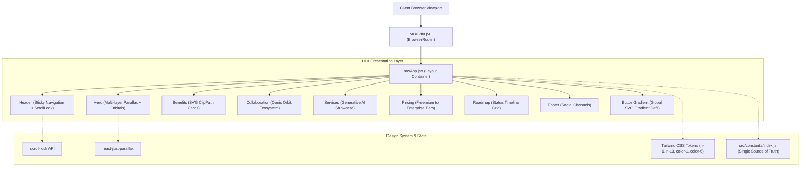
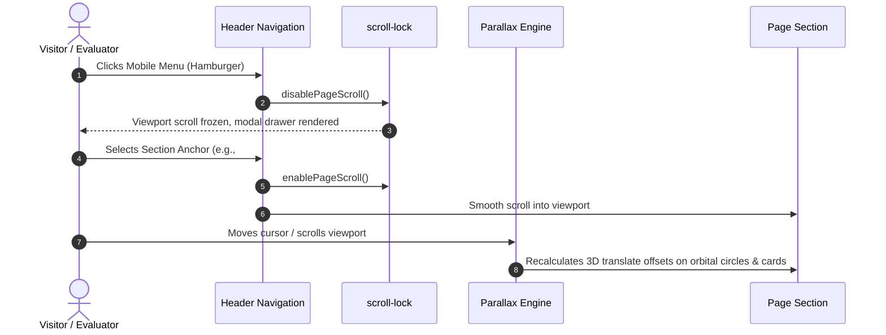

<div align="center">

# Yoralph | Futuristic AI SaaS & Portfolio Platform

An enterprise-grade, cyberpunk-inspired web application demonstrating advanced generative AI capabilities, multi-tier SaaS monetization patterns, and interactive micro-animations.

[](https://react.dev/)
[](https://vitejs.dev/)
[](https://tailwindcss.com/)
[](https://developer.mozilla.org/en-US/docs/Web/JavaScript)
[](https://eslint.org/)
[](https://nodejs.org/)
[](./LICENSE)

[Live Demo](http://localhost:5173/) • [Architecture](#system-architecture) • [Technical Docs](#technical-specifications) • [Roadmap](#roadmap--future-milestones)

</div>

---

## Executive Summary

**Yoralph (Brainwave)** is a high-performance Single Page Application (SPA) designed with a dual-purpose strategy:
1. **Engineering Showcase**: Demonstrating mastery of modern frontend development, custom vector masking, multi-layer parallax dynamics, and clean modular code standards.
2. **Commercial AI SaaS Framework**: A battle-tested foundation for a modern AI software product, incorporating tiered subscription models (Freemium, Pro, Enterprise), ecosystem app integrations, and feature roadmap visibility.

---

## System Architecture

### Component Hierarchy & Data Flow



### User Navigation & Parallax Interaction Sequence



---

## Key Features

- **Futuristic Neo-Brutalist & Cyberpunk Aesthetics**: Custom dark palette (`#0E0C15`), neon accent tokens, radial and conic gradient halos, and geometric crosshair markers (`PlusSvg`).
- **Dynamic Tri-Font Typography**: Precision typography system combining `Sora` (headings/body), `Space Grotesk` (uppercase tracked tags), and `Source Code Pro` (monospaced buttons/code badges).
- **Multi-Layer Parallax Physics**: Real-time cursor-tracking and scroll-depth simulation powered by `react-just-parallax`.
- **Custom Vector Masking**: SVG `<clipPath>` implementations allowing complex angled border cards without performance penalties.
- **Strict Code Quality**: Zero ESLint warnings with strict `prop-types` runtime schema enforcement across all components.

---

## Technical Specifications

<details>
<summary><b>1. Installation & Prerequisites</b></summary>

### System Prerequisites
- **Node.js**: `v20.0.0` or higher (verified on Node `v24.x`)
- **Package Manager**: `npm` `v10.x` or higher

### Local Setup
```bash
# Clone the repository
git clone https://github.com/AlphaIsYour/proyek-porto.git

# Navigate to project directory
cd proyek-porto

# Install dependencies cleanly
npm install

# Start local development server
npm run dev

# The app will be available at http://127.0.0.1:5173/
```

### Build & Lint Commands
```bash
# Execute production bundle build
npm run build

# Preview production build locally
npm run preview

# Run ESLint validation
npm run lint
```
</details>

<details>
<summary><b>2. Environment Configuration (.env.example)</b></summary>

Create a `.env` file in the root directory based on `.env.example`:

```env
# Application Metadata
VITE_APP_TITLE=Yoralph Portfolio & Brainwave AI
VITE_APP_URL=http://localhost:5173

# Optional: External AI APIs (for live sandbox extensions)
VITE_OPENAI_API_KEY=
VITE_GEMINI_API_KEY=

# Optional: Telemetry & Monitoring
VITE_ANALYTICS_ID=
```
</details>

<details>
<summary><b>3. Complete Directory Structure</b></summary>

```
proyek-porto/
├── public/                 # Static public assets (favicons, icons)
├── src/
│   ├── assets/             # Brand logos, service mockups, SVG graphics
│   │   ├── benefits/       # Card background SVGs
│   │   ├── roadmap/        # Roadmap milestone imagery
│   │   └── svg/            # Reusable SVG vector components
│   ├── components/         # Feature-specific and layout components
│   │   ├── design/         # Abstract visual accents (Gradients, Rings, Curves)
│   │   ├── Benefits.jsx    # Feature cards with custom vector clips
│   │   ├── Button.jsx      # Reusable polymorphic button component
│   │   ├── Collaboration.jsx # Interactive orbital ecosystem wheel
│   │   ├── CompanyLogos.jsx  # Trust validation banner
│   │   ├── Footer.jsx      # Social connectivity bar
│   │   ├── Generating.jsx  # Contextual AI status indicator
│   │   ├── Header.jsx      # Responsive header with scroll lock
│   │   ├── Heading.jsx     # Structured section title renderer
│   │   ├── Hero.jsx        # Primary visual anchor with parallax rings
│   │   ├── Notification.jsx # Floating micro-card simulation
│   │   ├── Pricing.jsx     # Subscription tier layout
│   │   ├── PricingList.jsx # Reusable tier cards
│   │   ├── Roadmap.jsx     # Production milestone grid
│   │   ├── Section.jsx     # Standardized section wrapper
│   │   ├── Services.jsx    # Generative AI feature breakdown
│   │   └── Tagline.jsx     # Monospace tag badge component
│   ├── constants/
│   │   └── index.js        # Centralized static configuration and content data
│   ├── App.jsx             # Top-level application layout
│   ├── index.css           # Global Tailwind declarations and font imports
│   └── main.jsx            # Application entrypoint with Router wrapper
├── .env.example            # Environment configuration template
├── eslint.config.js        # ESLint flat config with React & Refresh rules
├── index.html              # HTML5 entry document
├── package.json            # Project manifest, dependencies, and scripts
├── postcss.config.js       # PostCSS processing configuration
├── tailwind.config.js      # Tailored Tailwind theme tokens and presets
└── vite.config.js          # Vite build pipeline and plugin configuration
```
</details>

<details>
<summary><b>4. State Machine & Routing Architecture</b></summary>

### Navigation & Viewport State Flow
The navigation system relies on reactive URL hash changes synchronized with React Router DOM:

```
[Idle Viewport]
       │
       ▼ (User clicks anchor: #about, #project, #skill, #portfolio)
[Hash Change Detected]
       │
       ├─► (Desktop) Smooth scroll offset executed via CSS scroll-behavior: smooth
       │
       └─► (Mobile Drawer Open)
             ├─► Trigger disablePageScroll() to unlock scroll
             ├─► Toggle openNavigation = false
             └─► Animate drawer slide-out & restore native scroll
```

### Single Source of Truth (`src/constants/index.js`)
All content schemas (Navigation links, App integrations, Roadmap items, Pricing features, and Benefits cards) are separated from presentation logic into structured JSON constants. Adding or modifying features requires zero modifications to JSX markup.
</details>

<details>
<summary><b>5. Security Checklist & Best Practices</b></summary>

- [x] **Safe External Links**: All external hyperlinks utilize `rel="noopener noreferrer"` attributes.
- [x] **Prop Schema Validation**: All interactive components implement strict `PropTypes` to catch type coercion issues early.
- [x] **Zero Dynamic `eval` or Unsanitized HTML**: React DOM sanitizes all inner content by default; no `dangerouslySetInnerHTML` is used.
- [x] **Asset Optimization**: High-resolution graphics are compressed and served with explicit dimension parameters to avoid Cumulative Layout Shift (CLS).
- [x] **Strict Content Isolation**: Component styles are scoped through Tailwind utilities, preventing CSS namespace collisions.
</details>

---

## Roadmap & Future Milestones

For a detailed breakdown of planned enterprise features, user stories, and acceptance criteria, please consult [`ROADMAP_ISSUES.md`](./ROADMAP_ISSUES.md).

- **Q1**: Live AI Chatbot Sandbox with streaming LLM completions.
- **Q2**: Authentication & User Profile Management (OAuth2).
- **Q3**: Dynamic Checkout & Payment Gateway Integration.
- **Q4**: Headless CMS Portfolio Showcase & Multi-language Internationalization.

---

## Contributing

Contributions are welcomed. Please follow these conventions:
1. Fork the repository.
2. Create a feature branch (`git checkout -b feat/amazing-feature`).
3. Commit your changes with descriptive messages (`git commit -m 'feat: implement interactive chatbot sandbox'`).
4. Push to the branch (`git push origin feat/amazing-feature`).
5. Open a Pull Request.

---

## Author & License

Designed and maintained by **Alphareno ([@AlphaIsYour](https://github.com/AlphaIsYour))**.  
Undergraduate in Information Technology at Brawijaya University.

Distributed under the **MIT License**. See `LICENSE` for more information.
